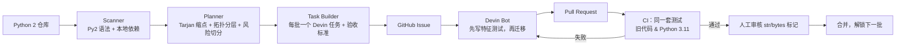
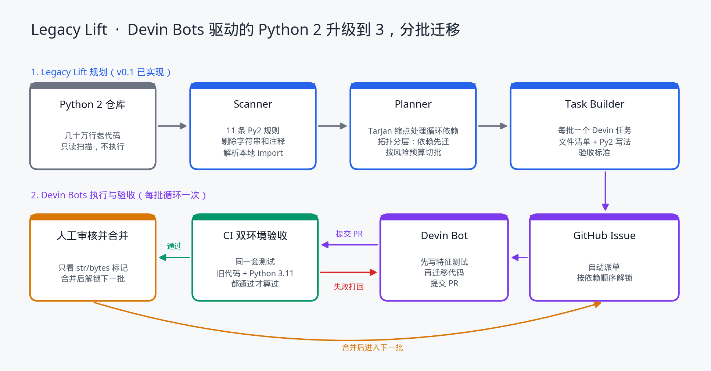

# Legacy Lift 🏗️

**让 Devin Bots 把老旧 Python 2 代码库安全地迁移到 Python 3：先规划，再分批，每一批都有测试兜底。**

还有大量公司的核心系统跑在 Python 2 上。迁移难的不是把 `print x` 改成 `print(x)`，难的是：几十万行代码，怎么拆成一个个可以审核、可以回滚、行为不变的 PR？Legacy Lift 负责规划和验收，Devin Bots 负责动手。

## 为什么难

| 难点 | 做法 |
| --- | --- |
| Python 2 源码用 Python 3 的 `ast` 解析不了 | 逐行扫描，并且先剔除字符串和注释，避免误报 |
| 模块之间互相 import，形成循环依赖 | 用 Tarjan 算法找出强连通分量，循环里的模块放进同一批 |
| 迁移顺序错了，PR 就没法单独测试 | 依赖图缩点后做拓扑分层，被依赖的模块先迁 |
| 一个 PR 太大，没人审得动 | 按风险点预算切分批次，`--max-risk` 可调 |
| 改完行为变了却没人发现 | 每批要求 Devin 先写特征测试（characterization tests），在旧代码上跑通后才动手 |
| `str` / `bytes` 语义要靠人判断 | `unicode`、`basestring` 记高风险，PR 里逐条标出来交给人审 |

## 架构





## v0.1 已经能跑

只依赖标准库，不需要安装任何包：

```bash
python -m legacy_lift tests/fixtures/py2_shop            # 输出迁移计划
python -m legacy_lift tests/fixtures/py2_shop --prompts  # 同时生成每批的 Devin 任务
python -m unittest discover -s tests -t .                # 11 个测试
```

在内置的样例仓库（7 个模块，含一个 `orders ↔ payments` 循环依赖）上输出：

```
# Migration plan: 7 modules, 5 batches, 21 risk points
## Batch 1 (risk 5, after -)     shop, shop.utils
## Batch 2 (risk 4, after #1)    shop.models
## Batch 3 (risk 9, after #2)    shop.orders, shop.payments   ← 循环依赖，同批迁移
## Batch 4 (risk 1, after #2,#3) shop.api
## Batch 5 (risk 2, after #4)    cli
```

## Devin Bot 怎么参与

Devin Bot 是执行主力，不是聊天助手：

1. **规划**：Legacy Lift 扫描仓库，生成批次和依赖顺序
2. **派单**：每一批自动建成一个 GitHub Issue，附上文件清单、已识别的 Py2 写法和验收标准
3. **执行**：Devin Bot 认领 Issue，先写特征测试并在旧代码上跑通，再迁移，最后提 PR
4. **验收**：CI 在新旧两个环境里跑同一套测试，全部通过、人审过 str/bytes 标记后合并
5. **推进**：一批合并后，自动解锁依赖它的下一批；进度每天汇报到 Slack

## 路线图

- [x] **第 1 周**：扫描器、依赖分析、分批规划、Devin 任务生成（v0.1，本仓库）
- [ ] **第 2 周**：GitHub 集成，自动建 Issue、追踪 PR 状态、按依赖自动解锁下一批
- [ ] **第 3 周**：特征测试生成，用 Python 2.7 和 3.11 双环境跑 CI
- [ ] **第 4 周**：找 3 个仍停留在 Python 2 的开源项目真实试跑，公开迁移报告和 PR 通过率

## 安全与权限

- 扫描只读，不执行目标仓库里的任何代码
- Devin Bot 只在独立分支上提 PR，不直接推 main
- 每个 PR 都必须通过 CI 和人工审核才能合并，可以随时回滚到任意一批
- 密钥放在 Devin Secrets 里，不写进任务描述和代码

## License

MIT
